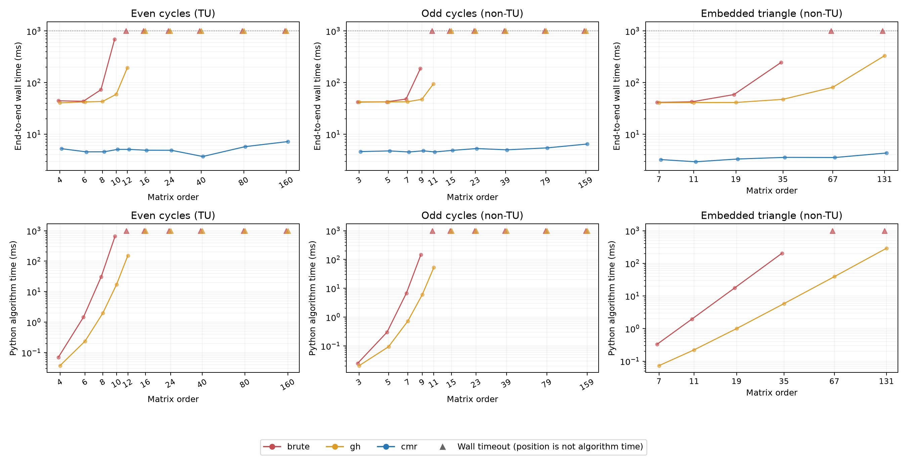
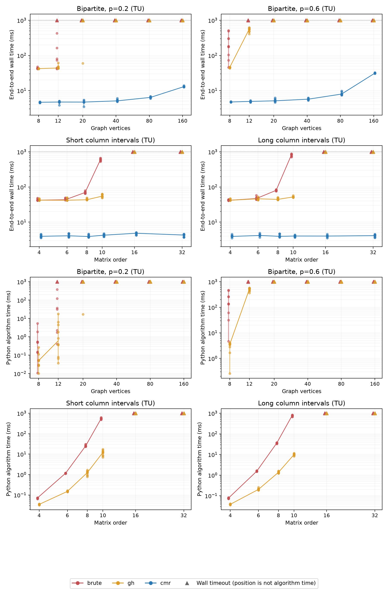
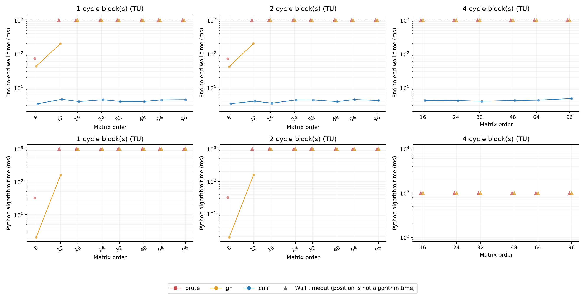

# E2 scaling and structure analysis

Source run: [measurements](../results/main_run/results.csv), [summary](../results/main_run/summary.csv) and [metadata](../results/main_run/metadata.json).

Generated from saved measurements by `analyse.py`; no recognition was rerun.

## How to read the results

Each input has 3 repetitions with a 1-second wall limit per invocation.
Each input first contributes its median across repetitions. A cell median then gives equal weight to its inputs.
Cell timings and ranges appear only if every input finished every repetition; otherwise the timing is **censored**.
The range is the minimum–maximum of input medians, not a confidence interval. Ten random draws are not thirty independent instances.
No timeout duration is substituted for an actual recognition time. Individual completed points may still appear in plots.

## Paired method comparisons

Comparisons use the same inputs, with every repetition complete for both methods. Brute/GH uses algorithm time, excluding worker startup and input/output; comparisons with CMR use end-to-end wall time. Ratios are A/B; above 1 favours B.
Incomplete pairs are excluded explicitly; their unobserved speed ratios cannot be inferred.

| Inputs | A | B | Timing | Eligible / shared | A faster | B faster | Median A/B |
|---|---|---|---|---:|---:|---:|---:|
| all | brute | gh | algorithm | 160/340 | 8 | 151 | 13.937 |
| main_only | brute | gh | algorithm | 133/300 | 8 | 124 | 10.449 |
| all | brute | cmr | wall | 160/340 | 0 | 160 | 13.874 |
| main_only | brute | cmr | wall | 133/300 | 0 | 133 | 13.266 |
| all | gh | cmr | wall | 183/340 | 0 | 183 | 11.614 |
| main_only | gh | cmr | wall | 153/300 | 0 | 153 | 11.106 |

Controls and transformed copies are included in `all`; `main_only` excludes transformed copies but retains controls.
The full family breakdown is in [paired.csv](paired.csv). Small timing differences are descriptive, not significance tests.

## Findings from the property comparisons

- At 12 graph vertices, GH's cell median was 43.9 ms at p=0.2 and 559.6 ms at p=0.6. Denser graphs also have more constraint rows, so this combines a size and density effect. These are separate random samples, not matched graph pairs.
- For 10x10 interval matrices, brute-force cell medians were 592.4 ms (short intervals) and 831.0 ms (long intervals). Both settings check all minors, but the entries affect determinant work. The effect is not universal: GH has no consistent increasing runtime pattern across the two interval settings.
- With dimensions and nonzero count fixed, CMR was faster with 2 blocks than one block at 5/8 tested orders. The mixed direction gives no consistent end-to-end benefit from adding blocks; these millisecond differences may reflect startup noise.
- With dimensions and nonzero count fixed, CMR was faster with 4 blocks than one block at 2/6 tested orders. The mixed direction gives no consistent end-to-end benefit from adding blocks; these millisecond differences may reflect startup noise.

## Runtime versus size and input properties

Bipartite size is graph vertex count; actual matrix rows vary with edge probability. Other size values are square matrix orders.
Changing p therefore changes both edge density and row count; it does not isolate density at fixed matrix dimensions.
Interval settings hold dimensions fixed but change interval lengths and nonzero count.
Block-cycle settings hold total dimensions and nonzero count fixed, varying the number of equal cycle blocks.

### even_cycle

Each entry is **completed inputs / inputs; median milliseconds [range]**. Censored means at least one input did not finish all repetitions.

| Setting | Size | Brute | GH | CMR |
|---|---:|---|---|---|
| default | 4 | 1/1; 44.569 [44.569, 44.569] | 1/1; 40.647 [40.647, 40.647] | 1/1; 5.260 [5.260, 5.260] |
| default | 6 | 1/1; 43.537 [43.537, 43.537] | 1/1; 42.371 [42.371, 42.371] | 1/1; 4.564 [4.564, 4.564] |
| default | 8 | 1/1; 72.975 [72.975, 72.975] | 1/1; 43.187 [43.187, 43.187] | 1/1; 4.576 [4.576, 4.576] |
| default | 10 | 1/1; 696.487 [696.487, 696.487] | 1/1; 59.445 [59.445, 59.445] | 1/1; 5.096 [5.096, 5.096] |
| default | 12 | 0/1; censored | 1/1; 195.401 [195.401, 195.401] | 1/1; 5.098 [5.098, 5.098] |
| default | 16 | 0/1; censored | 0/1; censored | 1/1; 4.907 [4.907, 4.907] |
| default | 24 | 0/1; censored | 0/1; censored | 1/1; 4.895 [4.895, 4.895] |
| default | 40 | 0/1; censored | 0/1; censored | 1/1; 3.711 [3.711, 3.711] |
| default | 80 | 0/1; censored | 0/1; censored | 1/1; 5.766 [5.766, 5.766] |
| default | 160 | 0/1; censored | 0/1; censored | 1/1; 7.223 [7.223, 7.223] |

### odd_cycle

Each entry is **completed inputs / inputs; median milliseconds [range]**. Censored means at least one input did not finish all repetitions.

| Setting | Size | Brute | GH | CMR |
|---|---:|---|---|---|
| default | 3 | 1/1; 42.018 [42.018, 42.018] | 1/1; 42.479 [42.479, 42.479] | 1/1; 4.621 [4.621, 4.621] |
| default | 5 | 1/1; 42.498 [42.498, 42.498] | 1/1; 42.320 [42.320, 42.320] | 1/1; 4.764 [4.764, 4.764] |
| default | 7 | 1/1; 48.200 [48.200, 48.200] | 1/1; 42.699 [42.699, 42.699] | 1/1; 4.540 [4.540, 4.540] |
| default | 9 | 1/1; 188.179 [188.179, 188.179] | 1/1; 47.577 [47.577, 47.577] | 1/1; 4.784 [4.784, 4.784] |
| default | 11 | 0/1; censored | 1/1; 94.160 [94.160, 94.160] | 1/1; 4.546 [4.546, 4.546] |
| default | 15 | 0/1; censored | 0/1; censored | 1/1; 4.880 [4.880, 4.880] |
| default | 23 | 0/1; censored | 0/1; censored | 1/1; 5.292 [5.292, 5.292] |
| default | 39 | 0/1; censored | 0/1; censored | 1/1; 4.999 [4.999, 4.999] |
| default | 79 | 0/1; censored | 0/1; censored | 1/1; 5.454 [5.454, 5.454] |
| default | 159 | 0/1; censored | 0/1; censored | 1/1; 6.472 [6.472, 6.472] |

### embedded_triangle

Each entry is **completed inputs / inputs; median milliseconds [range]**. Censored means at least one input did not finish all repetitions.

| Setting | Size | Brute | GH | CMR |
|---|---:|---|---|---|
| default | 7 | 1/1; 41.517 [41.517, 41.517] | 1/1; 40.962 [40.962, 40.962] | 1/1; 3.234 [3.234, 3.234] |
| default | 11 | 1/1; 42.520 [42.520, 42.520] | 1/1; 41.237 [41.237, 41.237] | 1/1; 2.933 [2.933, 2.933] |
| default | 19 | 1/1; 58.791 [58.791, 58.791] | 1/1; 41.346 [41.346, 41.346] | 1/1; 3.319 [3.319, 3.319] |
| default | 35 | 1/1; 245.746 [245.746, 245.746] | 1/1; 47.515 [47.515, 47.515] | 1/1; 3.568 [3.568, 3.568] |
| default | 67 | 0/1; censored | 1/1; 81.698 [81.698, 81.698] | 1/1; 3.545 [3.545, 3.545] |
| default | 131 | 0/1; censored | 1/1; 333.141 [333.141, 333.141] | 1/1; 4.337 [4.337, 4.337] |

### bipartite

Each entry is **completed inputs / inputs; median milliseconds [range]**. Censored means at least one input did not finish all repetitions.

| Setting | Size | Brute | GH | CMR |
|---|---:|---|---|---|
| p=0.2 | 8 | 10/10; 42.567 [41.433, 47.950] | 10/10; 42.276 [41.467, 42.838] | 10/10; 4.652 [4.454, 4.844] |
| p=0.2 | 12 | 7/10; censored | 10/10; 43.919 [42.378, 61.798] | 10/10; 4.720 [3.861, 5.041] |
| p=0.2 | 20 | 0/10; censored | 1/10; censored | 10/10; 4.707 [3.484, 5.382] |
| p=0.2 | 40 | 0/10; censored | 0/10; censored | 10/10; 5.098 [4.832, 6.067] |
| p=0.2 | 80 | 0/10; censored | 0/10; censored | 10/10; 6.396 [5.995, 6.879] |
| p=0.2 | 160 | 0/10; censored | 0/10; censored | 10/10; 12.903 [12.522, 13.874] |
| p=0.6 | 8 | 10/10; 179.649 [45.997, 511.898] | 10/10; 45.842 [42.908, 46.826] | 10/10; 4.739 [4.659, 4.865] |
| p=0.6 | 12 | 0/10; censored | 10/10; 559.617 [410.839, 620.345] | 10/10; 4.920 [4.614, 5.268] |
| p=0.6 | 20 | 0/10; censored | 0/10; censored | 10/10; 5.114 [4.634, 6.169] |
| p=0.6 | 40 | 0/10; censored | 0/10; censored | 10/10; 5.693 [5.224, 6.205] |
| p=0.6 | 80 | 0/10; censored | 0/10; censored | 10/10; 7.962 [7.358, 9.706] |
| p=0.6 | 160 | 0/10; censored | 0/10; censored | 10/10; 31.315 [30.604, 32.380] |

### interval

Each entry is **completed inputs / inputs; median milliseconds [range]**. Censored means at least one input did not finish all repetitions.

| Setting | Size | Brute | GH | CMR |
|---|---:|---|---|---|
| long | 4 | 10/10; 41.703 [40.817, 44.618] | 10/10; 41.937 [41.357, 47.008] | 10/10; 3.915 [3.537, 4.519] |
| long | 6 | 10/10; 46.831 [43.816, 57.883] | 10/10; 46.047 [42.267, 52.760] | 10/10; 4.163 [3.687, 4.865] |
| long | 8 | 10/10; 80.203 [75.498, 85.270] | 10/10; 44.344 [42.813, 50.551] | 10/10; 3.938 [3.652, 4.638] |
| long | 10 | 10/10; 831.042 [708.652, 878.107] | 10/10; 52.017 [49.471, 57.209] | 10/10; 4.015 [3.681, 4.335] |
| long | 16 | 0/10; censored | 0/10; censored | 10/10; 4.004 [3.511, 4.535] |
| long | 32 | 0/10; censored | 0/10; censored | 10/10; 4.120 [3.608, 4.514] |
| short | 4 | 10/10; 42.115 [41.348, 48.044] | 10/10; 42.109 [41.322, 46.986] | 10/10; 3.946 [3.562, 4.508] |
| short | 6 | 10/10; 43.333 [42.628, 49.061] | 10/10; 41.962 [41.534, 49.562] | 10/10; 4.076 [3.687, 4.795] |
| short | 8 | 10/10; 69.546 [65.189, 79.302] | 10/10; 43.291 [42.332, 49.085] | 10/10; 3.893 [3.689, 4.636] |
| short | 10 | 10/10; 592.448 [528.756, 661.250] | 10/10; 54.791 [49.146, 62.744] | 10/10; 4.243 [3.823, 4.726] |
| short | 16 | 0/10; censored | 0/10; censored | 10/10; 4.818 [4.232, 5.067] |
| short | 32 | 0/10; censored | 0/10; censored | 10/10; 4.286 [3.648, 4.614] |

### block_cycles

Each entry is **completed inputs / inputs; median milliseconds [range]**. Censored means at least one input did not finish all repetitions.

| Setting | Size | Brute | GH | CMR |
|---|---:|---|---|---|
| blocks=1 | 8 | 1/1; 73.827 [73.827, 73.827] | 1/1; 43.430 [43.430, 43.430] | 1/1; 3.364 [3.364, 3.364] |
| blocks=1 | 12 | 0/1; censored | 1/1; 200.126 [200.126, 200.126] | 1/1; 4.569 [4.569, 4.569] |
| blocks=1 | 16 | 0/1; censored | 0/1; censored | 1/1; 3.920 [3.920, 3.920] |
| blocks=1 | 24 | 0/1; censored | 0/1; censored | 1/1; 4.429 [4.429, 4.429] |
| blocks=1 | 32 | 0/1; censored | 0/1; censored | 1/1; 3.951 [3.951, 3.951] |
| blocks=1 | 48 | 0/1; censored | 0/1; censored | 1/1; 3.957 [3.957, 3.957] |
| blocks=1 | 64 | 0/1; censored | 0/1; censored | 1/1; 4.381 [4.381, 4.381] |
| blocks=1 | 96 | 0/1; censored | 0/1; censored | 1/1; 4.444 [4.444, 4.444] |
| blocks=2 | 8 | 1/1; 72.606 [72.606, 72.606] | 1/1; 42.340 [42.340, 42.340] | 1/1; 3.391 [3.391, 3.391] |
| blocks=2 | 12 | 0/1; censored | 1/1; 202.524 [202.524, 202.524] | 1/1; 4.021 [4.021, 4.021] |
| blocks=2 | 16 | 0/1; censored | 0/1; censored | 1/1; 3.498 [3.498, 3.498] |
| blocks=2 | 24 | 0/1; censored | 0/1; censored | 1/1; 4.387 [4.387, 4.387] |
| blocks=2 | 32 | 0/1; censored | 0/1; censored | 1/1; 4.369 [4.369, 4.369] |
| blocks=2 | 48 | 0/1; censored | 0/1; censored | 1/1; 3.905 [3.905, 3.905] |
| blocks=2 | 64 | 0/1; censored | 0/1; censored | 1/1; 4.489 [4.489, 4.489] |
| blocks=2 | 96 | 0/1; censored | 0/1; censored | 1/1; 4.205 [4.205, 4.205] |
| blocks=4 | 16 | 0/1; censored | 0/1; censored | 1/1; 4.252 [4.252, 4.252] |
| blocks=4 | 24 | 0/1; censored | 0/1; censored | 1/1; 4.183 [4.183, 4.183] |
| blocks=4 | 32 | 0/1; censored | 0/1; censored | 1/1; 4.010 [4.010, 4.010] |
| blocks=4 | 48 | 0/1; censored | 0/1; censored | 1/1; 4.212 [4.212, 4.212] |
| blocks=4 | 64 | 0/1; censored | 0/1; censored | 1/1; 4.310 [4.310, 4.310] |
| blocks=4 | 96 | 0/1; censored | 0/1; censored | 1/1; 4.815 [4.815, 4.815] |

## Paired representation checks

All completed variants agree with their construction labels. A timed-out variant does not establish a decision.
Counts below are variant–parent pairs; a parent may appear in several pairs. They are not independent samples.

| Method | Pairs | Both fully completed | Different completion counts | Median variant / parent |
|---|---:|---:|---:|---:|
| brute | 40 | 27 | 3 | 0.979 |
| gh | 40 | 30 | 0 | 0.962 |
| cmr | 40 | 40 | 0 | 0.856 |

Individual transformations and paired ratios are in [transformed_pairs.csv](transformed_pairs.csv).

## Figures

Circles show fully completed input medians. Lines join cell medians only when the whole cell completed.
Top panels use wall time for all methods; bottom panels use algorithm time for brute and GH only. CMR has no comparable saved algorithm time.
Whiskers show the range of input medians. Triangles mark wall-clock timeouts; their vertical position is not a measured algorithm time or an algorithm-time lower bound.
Colours identify methods. Horizontal offsets separate overlapping methods and are only visual.

Matching vector PDF files are available alongside each PNG for report export.

## Interpretation limits

Property tables and representation checks use end-to-end wall time. Brute/GH paired comparisons and the algorithm-time figure panels exclude Python startup and input/output.
Python-only algorithm timings must not be compared directly against CMR wall time. They do not resolve a tiny-input kernel crossover.
The run establishes empirical behaviour on these synthetic inputs, not polynomial/exponential bounds.
CMR may recognise these families by fast paths; a benefit from block structure alone does not identify which internal decomposition it used.
